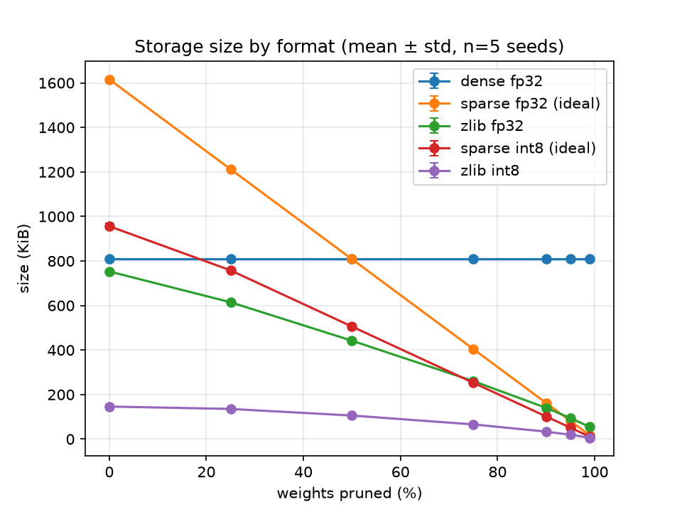

# Neural Network Compression Through Pruning and Quantization

Sreshth Tiwari

## 1. Objective

I'm interested in making machine learning models more efficient. Biological neural networks work with sparse connections, so I wanted to see whether an artificial network can keep its accuracy with fewer connections and lower numerical precision.

## 2. Setup

- Data: Fashion MNIST, 60,000 training and 10,000 test images (28×28 grayscale, 10 clothing classes). Pixels are normalized using the training set mean and std.
- Model: a small CNN with ~200k weights and 91.1% test accuracy. I used a CNN because it learns local visual patterns like edges and shapes, which helps with images.
- Pruning: zero out the smallest weights across the whole network, applied after training with no retraining.
- Quantization: round weights to 8 bit integers. This is simulated: they're converted back to float to run, so it shows the effect on accuracy but not any speed gain.
- Repeats: 5 separate training runs and results are mean ± std.

Samples from each class.

Storage is reported in several ways, because zeros don't shrink a dense file:

| Format | Meaning |
|---|---|
| dense fp32 / int8 | every weight stored, zero or not |
| sparse (ideal) | nonzeros × (value bytes + 4 byte index) |
| zlib | the dense bytes compressed with zlib, an actual file size, with nothing lost |

## 3. Results

(lines here overlap because the accuracies are almost the same)

Test accuracy (%), mean ± std over 5 seeds

| Pruned | Pruning only | Pruning + int8 |
|---|---|---|
| 0% | 91.13 ± 0.22 | 91.11 ± 0.17 |
| 25% | 91.21 ± 0.17 | 91.17 ± 0.17 |
| 50% | 91.05 ± 0.12 | 91.05 ± 0.12 |
| 75% | 89.63 ± 0.80 | 89.58 ± 0.82 |
| 90% | 78.42 ± 4.19 | 78.48 ± 4.18 |
| 95% | 55.54 ± 9.18 | 55.58 ± 9.11 |
| 99% | 18.59 ± 3.68 | 18.61 ± 3.65 |

Model size (KiB, weights + biases, mean over seeds)

| Pruned | dense fp32 | sparse fp32 (ideal) | zlib fp32 | dense int8 | sparse int8 (ideal) | zlib int8 |
|---|---|---|---|---|---|---|
| 0% | 808 | 1616 | 753 | 203 | 956 | 146 |
| 25% | 808 | 1212 | 615 | 203 | 758 | 135 |
| 50% | 808 | 808 | 442 | 203 | 505 | 106 |
| 75% | 808 | 405 | 261 | 203 | 253 | 66 |
| 90% | 808 | 162 | 140 | 203 | 102 | 33 |
| 95% | 808 | 81 | 94 | 203 | 51 | 19 |
| 99% | 808 | 17 | 55 | 203 | 11 | 6 |

Run time was about 0.21 to 0.23 s to go through the whole test set once (CPU, batch 1000) at every pruning level, with and without int8. The differences are within timing noise.
