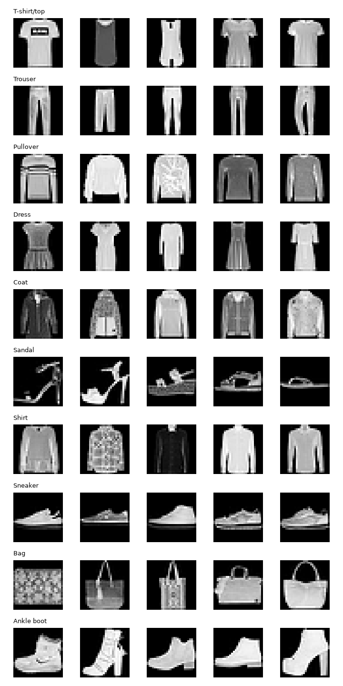
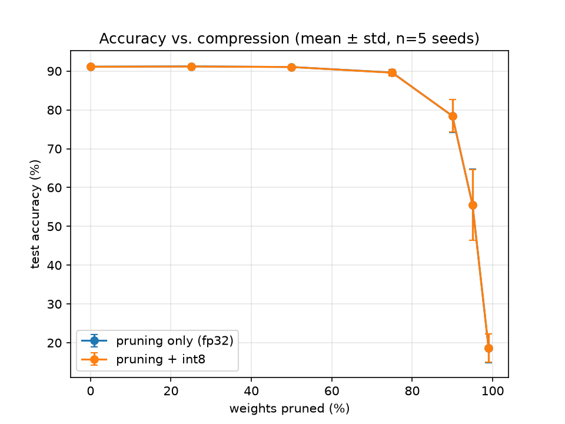
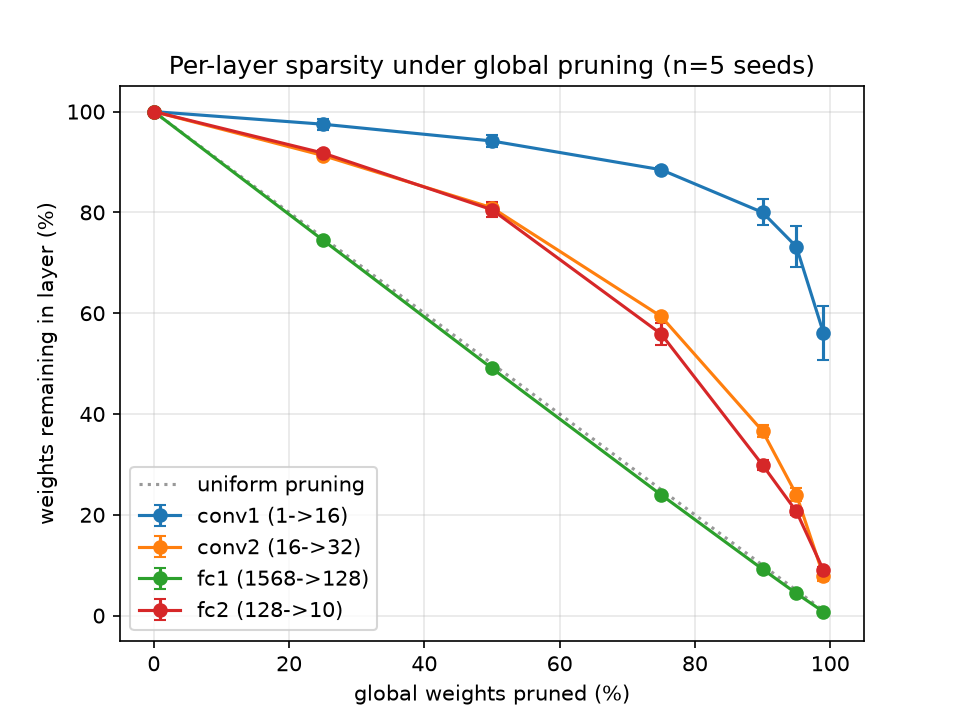

# Neural Network Compression Through Pruning and Quantization

Sreshth Tiwari

## 1. Objective

I'm interested in making machine learning models more efficient. Biological neural networks work with sparse connections, so I wanted to see whether an artificial network can keep its accuracy with fewer connections and lower numerical precision.

## 2. Setup

- Data: Fashion MNIST, 60,000 training and 10,000 test images (28×28 grayscale, 10 clothing classes). Pixels are normalized using the training set mean and std.
- Model: a small CNN with ~200k weights and 91.1% test accuracy. I used a CNN because it learns local visual patterns like edges and shapes, which helps with images.
- Pruning: zero out the smallest weights across the whole network, applied after training with no retraining.
- Quantization: round weights to 8 bit integers. This is simulated: they're converted back to float to run, so it shows the effect on accuracy but not any speed gain.
- Repeats: 5 separate training runs and results are mean ± std.

Samples from each class.

Storage is reported in several ways, because zeros don't shrink a dense file:

| Format | Meaning |
|---|---|
| dense fp32 / int8 | every weight stored, zero or not |
| sparse (ideal) | nonzeros × (value bytes + 4 byte index) |
| zlib | the dense bytes compressed with zlib, an actual file size, with nothing lost |

## 3. Results

(lines here overlap because the accuracies are almost the same)

Test accuracy (%), mean ± std over 5 seeds

| Pruned | Pruning only | Pruning + int8 |
|---|---|---|
| 0% | 91.13 ± 0.22 | 91.11 ± 0.17 |
| 25% | 91.21 ± 0.17 | 91.17 ± 0.17 |
| 50% | 91.05 ± 0.12 | 91.05 ± 0.12 |
| 75% | 89.63 ± 0.80 | 89.58 ± 0.82 |
| 90% | 78.42 ± 4.19 | 78.48 ± 4.18 |
| 95% | 55.54 ± 9.18 | 55.58 ± 9.11 |
| 99% | 18.59 ± 3.68 | 18.61 ± 3.65 |

Model size (KiB, weights + biases, mean over seeds)

| Pruned | dense fp32 | sparse fp32 (ideal) | zlib fp32 | dense int8 | sparse int8 (ideal) | zlib int8 |
|---|---|---|---|---|---|---|
| 0% | 808 | 1616 | 753 | 203 | 956 | 146 |
| 25% | 808 | 1212 | 615 | 203 | 758 | 135 |
| 50% | 808 | 808 | 442 | 203 | 505 | 106 |
| 75% | 808 | 405 | 261 | 203 | 253 | 66 |
| 90% | 808 | 162 | 140 | 203 | 102 | 33 |
| 95% | 808 | 81 | 94 | 203 | 51 | 19 |
| 99% | 808 | 17 | 55 | 203 | 11 | 6 |

Run time was about 0.21 to 0.23 s to go through the whole test set once (CPU, batch 1000) at every pruning level, with and without int8. The differences are within timing noise.

## 4. Discussion

Accuracy stayed pretty much the same as
the unpruned baseline up until 50% pruning (differences ≤0.1 points, smaller than the seed to seed std). It dropped by ~1.5 points at 75%. After that it drops significantly: ~78% at 90%, ~56% at 95%, and ~19% at 99%. This model is bigger than it needs to be for the task, but not without limit.
Results also vary much more between seeds as pruning increases (std 0.2 → 9 points). So which
weights matter most differs a lot between runs once pruning is heavy.

Int8 quantization is almost free. Its accuracy
matches fp32 at every pruning level (≤0.1 point differences, well within random variation), and
cuts dense size 4× (808 → 203 KiB). Pruning is free only up to ~50%, then costs accuracy
quickly. Per unit of accuracy lost, quantization is the better first step.

Combining helps for size and costs no extra accuracy. The smallest reasonable setup (75% pruned + int8 with zlib compression) is ~66 KiB versus
808 KiB dense fp32. It's about 12× smaller at a cost of ~1.5 accuracy points. Pruning 50% + int8 gives
~106 KiB (~7.6×) with no measurable loss. A side effect is that rounding to int8 itself zeroes about 5%
of weights at 0% pruning (nonzero fraction 94.6%), so quantization adds a little sparsity on its own.

Sparsity isn't the same as savings:
- A dense file stays 808 KiB at every pruning level, because zeros are still stored.
- Sparse storage has to store positions (indices). At 0% pruning the best sparse format is twice as large as dense
  (1616 vs. 808 KiB) and it only breaks even at 50% sparsity for fp32.
- Run time didn't change at all. Standard dense code does the same multiplications even when weights are zero, so a speedup would need code built for sparse data or structured pruning (removing whole channels or neurons). My int8 version is simulated, so I make no claim about int8 speed.

### Per layer sparsity

Since I used global pruning, the layer holding most of the weights absorbs most of the pruning. `fc1` holds 200,704 of 206,736 weights (97.1%); the two conv layers hold only 4,752 combined.

Weights remaining per layer (%), mean over 5 seeds

| Pruned (global) | conv1 (144 w) | conv2 (4,608 w) | fc1 (200,704 w) | fc2 (1,280 w) |
|---|---|---|---|---|
| 25% | 97.5 | 91.3 | 74.5 | 91.8 |
| 50% | 94.2 | 80.9 | 49.1 | 80.5 |
| 75% | 88.5 | 59.4 | 24.0 | 55.9 |
| 90% | 80.0 | 36.6 | 9.2 | 29.9 |
| 95% | 73.2 | 24.0 | 4.4 | 20.7 |
| 99% | 56.1 | 7.9 | 0.8 | 9.0 |

At 50% global pruning, `fc1` is the only layer losing about half its weights while the small
layers stay mostly intact. By 90 to 99%, the small layers are being pruned heavily too (conv2 keeps 37%
at 90% and 8% at 99%). These layers have little redundancy to spare, which is consistent with, but
doesn't prove, the accuracy collapse starting there. I didn't run a controlled test like
pruning each layer by itself. So the claim "the network tolerates 50% pruning" is mostly about
the oversized `fc1` layer, not the whole network equally.

### Connection to biological networks

Brains are sparse. A neuron connects to only a very small fraction of the other neurons, and synapses are thought to be noisy (so they can't hold very precise values). This network kept its accuracy with half of its weights removed and with 8 bit weights, which fits the idea that a lot of connections and precision aren't needed for a task like this. Brains also lose many synapses during development, which is slightly similar to pruning.

I don't want to take this too far. Pruning a trained network by weight size is an engineering method and one small CNN on Fashion MNIST can't really say anything about real neural circuits. The accuracy collapse past 90% also shows there's a limit to how sparse this network can get.
